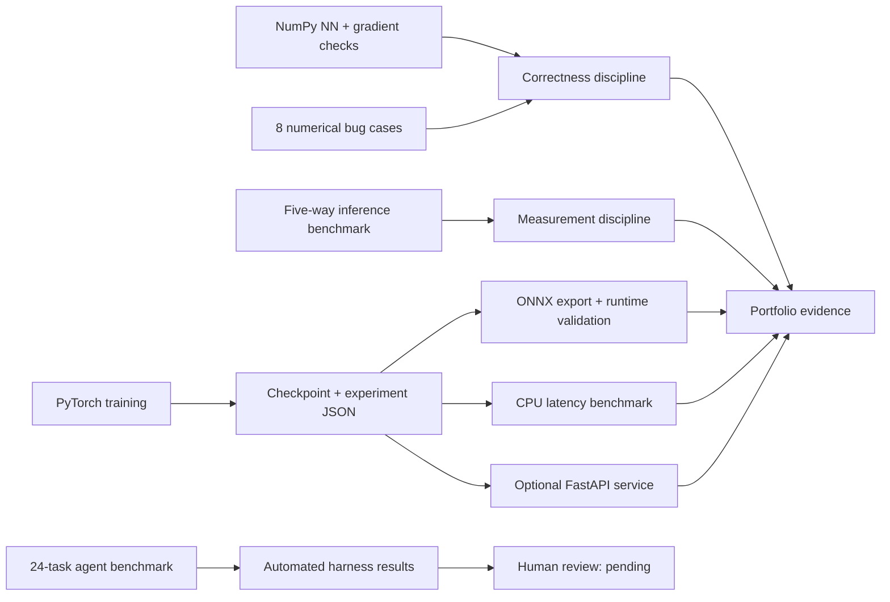

# ML Engineering Portfolio

[](https://github.com/yazanus94-dot/ML-Engineering-Portfolio_proj/actions/workflows/ci.yml)


Five projects around the part of ML engineering that decides whether a model
ever reaches production: **numerical correctness, reproducibility, measurement,
and the path from training to serving**. Every quantitative claim is checked by
tests and generated by the exact command shown.

| # | Project | What it shows | Validation |
|---|---------|---------------|------------|
| 1 | [ml-numpy-from-scratch](ml-numpy-from-scratch/) | A neural network (Linear, ReLU, Tanh, LayerNorm, causal self-attention) with **hand-written backpropagation**, stable softmax cross-entropy, SGD/Adam — and **central-difference gradient checking of every layer** | 11 tests incl. gradient checks; deterministic training run (spiral dataset, 97.3% test accuracy, committed `reports/spiral_run.json`) |
| 2 | [ml-numerical-debugging-lab](ml-numerical-debugging-lab/) | **Eight realistic ML bugs** — softmax overflow, log-of-zero, wrong axis reduction, train/test leakage, float16 accumulation, variance cancellation, softplus overflow, silent broadcasting — each with symptom, root cause, fix, and a test that reproduces the bug | 6 tests: every bug reproduced, every fix verified; generated `docs/cases.md` write-up |
| 3 | [ml-inference-benchmark](ml-inference-benchmark/) | One seeded MLP **implemented five ways** (float64 reference, pure-Python, per-sample NumPy, batched float32, int8-quantised with int32 accumulation) with a harness measuring median latency, throughput, weight memory and peak allocation | 6 tests: correctness within explicit tolerance, determinism, quantisation error bound, memory ratio, report completeness |
| 4 | [ml-pytorch-training](ml-pytorch-training/) | Seeded PyTorch MLP training with **checkpointing, experiment manifests, ONNX export + runtime numerical validation, CPU latency benchmarking and optional FastAPI serving** | 8 tests: determinism, checkpoint schema, split balance, generalization, ONNX logit agreement, API routes; committed reports from a real run |
| 5 | [coding-agent-benchmark](coding-agent-benchmark/) | 24 reproducible Python engineering tasks spanning correctness, edge cases, numerical stability, performance, regression risk and test coverage | 3 harness tests + 24/24 golden-solution self-check; **not an agent score** (human review pending) |

## The engineering habits

- **Gradient-checked backprop.** Hand-derived gradients are verified against
  finite differences — not assumed correct because training loss goes down.
- **Bugs as test cases.** The debugging lab reproduces each numerical failure
  first, then proves the fix, so the knowledge is executable.
- **Measurement with error bars.** The benchmark reports median-of-repeats
  latency, memory via `tracemalloc`, and validates every implementation
  against the float64 reference within a stated tolerance — no silent drift.
- **Determinism.** Seeded generators everywhere; the training-run report is
  committed and regenerated identically on each run.
- **Deployment path verified, not assumed.** A PyTorch checkpoint is exported
  to ONNX and ONNX Runtime logits are compared against PyTorch (max difference
  9.54e-07); CPU latency and an optional API surface are exercised from the
  same checkpoint.
- **Agent work is evidenced.** [docs/coding-agent-evidence.md](docs/coding-agent-evidence.md)
  records real commits, CI runs, a real CI failure, rejected suggestions and
  corrections from this session — no invented agent experiments.

## Quick start

```bash
# 1. NN from scratch: gradient checks + deterministic training
cd ml-numpy-from-scratch
python -m pytest -q
python scripts/train_spiral.py

# 2. Numerical debugging lab: reproduce 8 bugs and their fixes
cd ../ml-numerical-debugging-lab
python -m pytest -q
python -m lab.report

# 3. Inference benchmark: five implementations, latency + memory + error
cd ../ml-inference-benchmark
python -m pytest -q
python -m infbench.run --batch 64 --repeats 5

# 4. PyTorch: train -> checkpoint -> ONNX validate -> CPU benchmark
cd ../ml-pytorch-training
python -m pip install -r requirements.txt -r requirements-serving.txt
python -m pytest -q
python -m pytorch_lab.train --output reports
python -m pytorch_lab.export_onnx --checkpoint reports/checkpoint.pt
python -m pytorch_lab.benchmark_cpu --checkpoint reports/checkpoint.pt

# 5. Coding-agent benchmark harness (golden self-check)
cd ../coding-agent-benchmark
python -m pytest -q
python -m bench.run
```

The CI workflow runs all five suites on Python 3.11 / 3.12 / 3.13. It has not
been executed remotely from this feature branch because publication requires
your approval; local results are recorded in each project's README.

## Architecture



## Scope

Self-directed portfolio projects by Yazan Aljabari demonstrating ML
engineering practice (implementation, numerical correctness, reproducibility,
testing). They are not production software; reported results come from the
exact commands shown.

## License

MIT, see [LICENSE](LICENSE).
